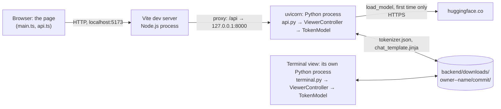

# Token viewer

A token viewer for chat requests: given a model on Hugging Face and a list of chat messages, it shows the exact tokens the model reads. It has two views on the same model and controller classes: a page in the browser, written in TypeScript, and a terminal view.

For the course request, one user message "Explain tokenization in one sentence." to Nemotron 3.5 Lightning, it shows the known 24 tokens, the same IDs `uv run tokenize-chat` prints in the course repository's `token_lab`. It also handles characters a tokenizer cuts into bytes, such as the emoji 👋🏽, and reads captured provider responses. Built from the [starter](https://github.com/L3GJ0N/eaas_token_viewer_starter) for the [token viewer exercise](https://github.com/L3GJ0N/engineering_agentic_ai_systems_hs_aalen/blob/main/exercises/token_viewer/README.md), as a side project.

## 1. Run everything

You need four tools:

- **Git** to clone the repository: [git-scm.com](https://git-scm.com/downloads) has it for Windows, macOS and Linux; on macOS, typing `git` in a terminal also offers to install it. Check with `git --version`.
- **uv** for Python: see its [installation guide](https://docs.astral.sh/uv/getting-started/installation/). Check with `uv --version`.
- **Node.js 24 LTS or newer** for the page. On Windows and macOS, use the installer from [nodejs.org](https://nodejs.org/en/download). On Linux, use one of the version managers nodejs.org recommends, for example `nvm install --lts`; the `nodejs` package of a distribution is often too old. Check with `node --version`: v24 or newer.
- **VS Code 1.112 or newer** with the extensions the workspace recommends: Python, Python Debugger and Ruff. **Help > About** shows the version (on macOS, **Code > About Visual Studio Code**); the debug configuration **Full stack: back end + browser** needs 1.112.

In WSL, follow the Linux steps inside WSL: clone into the WSL file system, open the clone in a VS Code WSL window, and never share `.venv` or `node_modules` with Windows.

From a fresh clone, open the repository in VS Code as a workspace, not as a folder: **File > Open Workspace from File**, then choose `token_viewer.code-workspace`. Only then does VS Code use the back end's and the page's own settings and debug configurations, **Full stack: back end + browser**, and the setting that keeps editor AI suggestions off. If you opened the folder with **File > Open Folder**, VS Code offers **Open Workspace** in a notification: choose it. When VS Code asks whether you trust the authors, choose **Yes, I trust the authors**: in Restricted Mode, debugging and tasks are switched off. Open **Terminal > New Terminal**; VS Code asks for a folder, so choose **repository**. Then:

```console
cd backend
uv sync
uv run uvicorn token_viewer.api:app --port 8000
```

The back end now listens on <http://127.0.0.1:8000>; <http://127.0.0.1:8000/docs> lists every route. It does not reload: after you change Python code, stop it with Ctrl+C and start it again ([GUIDE.md](GUIDE.md#debugging) says why). Leave it running and open a second terminal, again in **repository**:

```console
cd frontend
npm ci
npm run dev
```

Open <http://localhost:5173>. In **Repository** type `nvidia/NVIDIA-Nemotron-3.5-Lightning-30B-A3B-NVFP4`, in **Revision** `bee7596271d1495f6992ae224aefde4410e816b8`, and click **Load model**. The first time, the back end downloads about 17 MB from Hugging Face; from then on it works offline. The page then shows the 24 tokens of the course request.

The terminal view runs in a process of its own, with its own controller and model. In a third terminal, again in **repository**:

```console
cd backend
uv run token-viewer-terminal
```

It loads the course model at the pinned revision and prints the 24 tokens. `uv run token-viewer-terminal --help` lists the options, for example:

```console
uv run token-viewer-terminal --select 10
uv run token-viewer-terminal --text "Hi 👋🏽" --view message-1
uv run token-viewer-terminal --thinking on
uv run token-viewer-terminal --capture tests/data/made_up_nvidia_capture.json --view capture-answer
```

The tests and checks: see [Checks](#checks).

## 2. Process map

While you develop, the page and the back end run in separate processes:



Vite's proxy passes every request under `/api` on to uvicorn, so the page and the API share one origin and need no CORS.

- **The model's files** come from Hugging Face when the `load_model` command runs, not at start-up: `hub.py` calls `hf_hub_download` for `tokenizer.json`, `chat_template.jinja` and `tokenizer_config.json` (the last two when the repository has them), with no login. They land in `backend/downloads/<owner>--<name>/<commit>/`, and a `files.json` written last marks the folder complete. A commit never changes, so later loads, in either process, read that folder and send no request.
- **The terminal view** runs in its own Python process, started by `uv run token-viewer-terminal`. It calls `build_controller()` in `wiring.py` just as `api.py` does, so it uses the same classes with its own instance. It sends its commands, prints the last view-model and exits.
- **The state** lives in the uvicorn process, in the one `TokenModel` that `build_controller()` made: the loaded tokenizer, the messages, the template switches, the capture, the current view and the selection. When uvicorn restarts, all of that is gone and the page shows "No model loaded yet"; the downloaded files stay on disk, so **Load model** is quick and offline again.
- **The debuggers**: **Back end: uvicorn** attaches debugpy to the uvicorn process, where the route, the controller and the model run. **Front end: integrated browser** attaches to the browser tab that runs the page's TypeScript. No debugger attaches to Vite: it only serves files and forwards `/api`.

## 3. Debugging

Stop the back end from section 1 by closing its terminal (**Kill Terminal**) or with Ctrl+C in it, and keep Vite running. Then select **Run and Debug**, choose **Full stack: back end + browser** and click **Start Debugging**.

Follow one click on a token chip from the browser to the model:

1. `frontend/src/main.ts`, in `chip`, on `void run(() => selectToken(token.index))`: **Variables** shows `token`, the chip's `TokenView`.
2. `frontend/src/api.ts`, on `if (!response.ok)`: **Network** shows `POST /api/selection` waiting while Python is paused.
3. `backend/src/token_viewer/api.py`, in the route `select`: `body.index` is the request FastAPI parsed.
4. `backend/src/token_viewer/viewer_controller.py`, in `select_token`; then `model.py`, in `TokenModel.select`: `self.sequences`, `self.view` and `index`.

For **Load model** or **Set messages**, two more breakpoints in `model.py`:

- In `_render`, on `return environment.from_string(...).render(`: **Variables** shows `messages`, `switches` (`{'enable_thinking': False}`) and `loaded.template`, the template's source. Step over it to see the rendered text.
- In `_encode`, on `encoding: Encoding = loaded.tokenizer.encode(...)`: `text` is what the template wrote; after the step, `encoding.ids` holds the 24 IDs and `encoding.tokens` the vocabulary entries. In `_describe`, `pieces` holds each token's bytes and `boundaries` where each character begins.

If your code ever reads a key or a Hugging Face token, collapse **Variables** before you share your screen.

## 4. What works

1. **The 24 tokens in the terminal view.** `uv run token-viewer-terminal` loads Nemotron's `tokenizer.json` and `chat_template.jinja` at the pinned commit `bee75962…`, renders the template on the course message with `enable_thinking=False` and encodes the text: 24 tokens, the same IDs as `token_lab`, with index, ID, vocabulary entry, text, offsets, the five special tokens marked and the count. The view **message-1** is the text alone: 8 tokens. `tests/test_model.py` checks the IDs against the known list once the files are downloaded.
2. **The page.** After **Load model** as in section 1, the page shows the same 24 tokens through `ViewerController`; click a chip for its details. The page and the terminal view run in separate processes, each with its own controller and model, built by `build_controller()`.
3. **The emoji case and the offsets.** Every token has `start` and `end` in code points and `byte_start` and `byte_end` in UTF-8 bytes. Set the messages to `[{"role": "user", "content": "Hi 👋🏽 there"}]` and choose **Message 1 (user), text alone**: Nemotron cuts 👋🏽 into seven tokens. Each is marked `partial`, spans the whole character it cuts, and shows the bytes it carries, such as ` ⟨F0 9F⟩`; `bytes` lists them in hex. In the terminal: `uv run token-viewer-terminal --text "Hi 👋🏽 there" --view message-1`.
4. **Captures.** **Load capture** reads a file written by `capture-nvidia-response`. The views offer **Captured request, after the chat template**, **Answer, re-tokenized** and, when the response has one, **Reasoning, re-tokenized**, each with a notice that it is a local re-tokenization. **Response metadata** lists the requested and the reported model, the provider, the HTTP status, the finish reason, the usage, the elapsed time and the prompt tokens, local versus reported, each with its source. The course's sample capture is not out yet: `backend/tests/data/made_up_nvidia_capture.json` is a made-up one in the same format, for trying it.
5. **Optional, partly.** Any public repository with a `tokenizer.json` loads: a branch such as `main` is resolved to its commit first, a template kept in `tokenizer_config.json` is found, and a tokenizer that is not byte-level falls back to the offsets it reports.

## 5. Architecture

| Role | In this repository | May not |
|---|---|---|
| Model | `model.py` (`TokenModel`), `hub.py` (fetching), `capture.py` (reading captures), `course.py` (the course request as data) | import a view, a UI library or a web framework such as FastAPI |
| Controller | the interface in `controller.py` and `ViewerController` in `viewer_controller.py`; `wiring.py` chooses it | render anything (HTML, terminal output) |
| View | the page in `frontend/` with its routes in `api.py`; the terminal view in `terminal.py` | import the tokenizer libraries, contain domain logic |

[GUIDE.md](GUIDE.md#the-contract) explains the contract between the view-models and the page, and the two meanings of model and view.

- **The view-model.** `TokenView` gained `byte_start`, `byte_end`, `bytes`, `added` and `partial`; `ViewModel` gained `template_switches`; `CaptureView` gained `metadata`, a list of `MetadataView` with a label, a value and a source. The page needed no change: it shows further fields of a token in the detail panel, and further fields as JSON. Only `src/schema.d.ts` was regenerated with `npm run types`.
- **The state** lives in `TokenModel`: the loaded files, the messages, the template switches, the capture, the views computed from them, the current view and the selection. Every operation computes the new views first and assigns everything at once in `_commit`, so a refused operation changes nothing. `ViewerController` holds only a reference to the model.
- **The switch to the real controller** was one change in `wiring.py`: `FakeController()` became `ViewerController(TokenModel(HubFetcher(DOWNLOADS)))`. The fake stays for the route tests.

## 6. Decisions

- **Files and revision.** `nvidia/NVIDIA-Nemotron-3.5-Lightning-30B-A3B-NVFP4`, the variant NVIDIA Build runs, at commit `bee7596271d1495f6992ae224aefde4410e816b8`, the same as `token_lab`. Only `tokenizer.json`, `chat_template.jinja` and, if present, `tokenizer_config.json`: about 17 MB, not the 21.6 GB of weights. A pinned commit gives the same files every time; a branch name is resolved to a commit before downloading, and the page shows the commit.
- **Libraries.** `tokenizers` to encode, `jinja2` to render the template, `huggingface-hub` to download: the same three as `token_lab`, with the same version ranges. Not `transformers`: its `apply_chat_template` gives the same tokens but hides the steps and is a far larger install. The template runs in Jinja's `ImmutableSandboxedEnvironment` with the settings, the `tojson` filter and the helpers Transformers gives it, because it is code downloaded from the internet.
- **Template switches** belong to the request, next to the messages: they change the text the template writes, as the messages do. NVIDIA's request sends them as `chat_template_kwargs`. So they live in the model, start as the course request's `{"enable_thinking": false}`, come back in the view-model as `template_switches`, and change with a command of their own, `set_template_switches` (`POST /api/template-switches`, or `--thinking on` in the terminal). A capture keeps the switches its own request sent, and its prompt is rendered with those.
- **Offsets** count Unicode code points, the unit of a Python `str`: `text[start:end]` is a token's span. A byte-level tokenizer can cut a character into several tokens; code points cannot say where inside the character a cut falls, so such a token spans the whole character, is marked `partial`, and `byte_start` and `byte_end` give its exact place in the UTF-8 bytes. Code points are not the page's unit, UTF-16: an emoji is two UTF-16 units but one code point, so a TypeScript `slice` with these offsets would be wrong for it. The page does not slice the text; it shows `TokenView.text`, which Python builds.
- **Capture metadata.** Each piece has a source. *request*: what the laptop sent, the requested model, the URL and the template switches. *provider*: what NVIDIA's service answered, the HTTP status, the reported model, the finish reason and the usage with its prompt tokens. *local*: what the laptop measured, the elapsed time and the whole call's time, and what this viewer reconstructs, the provider's name from the URL's host and the prompt tokens counted with the local tokenizer. The views show the source next to each value, and the re-tokenized views say in their notice that they are a reconstruction: the provider returns text, not the token IDs it generated.
- **Departures from textbook MVC.** The view-model is a snapshot every command returns, not an observer the model notifies: HTTP has no push, and both views simply redraw from it. The routes in `api.py` belong to the page's side of the view but run in the back end's process. The model also does input checks a textbook controller might do, so that the terminal view and the page cannot get different rules.

## 7. AI use

Every prompt goes into [AI_USAGE.md](AI_USAGE.md). Editor AI suggestions stay off: the workspace switches off VS Code's inline suggestions and Copilot's next edit suggestions, because they write code without a prompt that could go into the log. Chat stays available for questions and hints.

This repository is a side project, not handed in for a grade. Its code was written with Claude (Anthropic), as [AI_USAGE.md](AI_USAGE.md) records.

## Checks

Run each block from the repository folder, each in a terminal of its own:

```console
cd backend
uv run ruff check
uv run ruff format --check
uv run mypy
uv run pytest
```

```console
cd frontend
npm run build
npm run types:check
```

The route tests send requests to the app inside the test process, against the fake controller, and `test_controller.py` checks the controller interface itself. `test_model.py` checks the model, the controller and the fetcher with a small tokenizer it trains itself; its three tests with Nemotron's real files run once the files are in `backend/downloads`, after the first `uv run token-viewer-terminal`. None of them needs a server or the network.

`npm run build` type-checks the page with `tsc` and then builds it. `npm run types` and `npm run types:check` read the description of the running back end, so they need a back end started after your last change to the Python code: restart it first. `npm run types:check` fails when `src/schema.d.ts` no longer matches the view-models.

## Versions

The back end needs Python 3.11 or newer; uv installs Python 3.13, which `backend/.python-version` names, if it is missing. `backend/uv.lock` pins FastAPI 0.159, uvicorn 0.54 and Pydantic 2.14. `frontend/package-lock.json` pins Vite 8.3 and TypeScript 5.9. Keep TypeScript at 5.9: [GUIDE.md](GUIDE.md#versions) says why.

## Troubleshooting

| What you see | Check |
|---|---|
| **Run and Debug** offers no configurations, or no **Full stack: back end + browser** | VS Code opened a folder, not the workspace. Use **File > Open Workspace from File** and choose `token_viewer.code-workspace`: the full-stack configuration exists only there. |
| Starting **Full stack: back end + browser** reports "Configured debug type 'editor-browser' is not supported" | VS Code is older than 1.112. Update it with **Help > Check for Updates** (on macOS, **Code > Check for Updates**). Until then, start **Back end: uvicorn**, then **Front end: browser (Edge)** or **(Chrome)**. |
| **Run and Debug** and the task **uv: sync** do nothing, and the status bar says **Restricted Mode** | You chose not to trust the folder. Click **Restricted Mode** and choose **Trust**: it is your group's code. |
| The page says "Waiting for the back end…" | Expected while the back end works on a command or waits at a breakpoint. At a breakpoint, click **Continue** in the debug toolbar. |
| The page says "Waiting for the back end to start (HTTP 502)…" or "The back end does not answer (HTTP 502).", or a command fails with HTTP 502 | The back end is not running; Vite's terminal shows "http proxy error". Start it (section 1) or the debugger (section 3). On the first load, the page keeps asking for 20 seconds; after that, click **Retry**. After a failed command, send it again. |
| The page says "No answer from the page's server. Is npm run dev still running?", or <http://localhost:5173> does not load | Vite is not running, and no debug configuration starts it. Start it in a terminal in `frontend` with `npm run dev`. |
| <http://127.0.0.1:8000> answers `{"detail":"Not Found"}`, or <http://127.0.0.1:8000/docs> stays blank | Expected: no route serves `/`. The page at `/docs` loads its scripts from cdn.jsdelivr.net, so it needs the internet. |
| A command fails with HTTP 500 | Python raised an exception: a bug. uvicorn prints the traceback in its terminal; under the debugger, that is the terminal **Python Debug Console**. |
| Python breakpoints never stop, but the page works | Another back end still holds port 8000, so the debugger's uvicorn stopped at once; its terminal shows "error while attempting to bind on address". Click **Stop**, stop the other back end with Ctrl+C in its terminal or by closing that terminal (**Kill Terminal**), and start debugging again. |
| uvicorn stops with "error while attempting to bind on address ('127.0.0.1', 8000)" | Another back end already runs on port 8000, in a terminal or under the debugger. Stop it with Ctrl+C in its terminal, by closing that terminal (**Kill Terminal**), or with **Stop** in the debug toolbar. On Windows the message goes on with "[winerror 10048]" and a text in the language of Windows. |
| `npm run dev` stops because port 5173 is in use | Another Vite server is still running. Stop it with Ctrl+C in its terminal, or close that terminal (**Kill Terminal**). |
| `npm run types` or `npm run types:check` stops with "ResolveError: fetch failed" and "ECONNREFUSED 127.0.0.1:8000" | The back end is not running. Start it, then run the command again. |
| On Windows, PowerShell refuses to run `npm` with a message that points to `about_Execution_Policies` (in English: "running scripts is disabled on this system") | Type `npm.cmd` instead of `npm`, or allow local scripts for your Windows account with `Set-ExecutionPolicy -Scope CurrentUser RemoteSigned`; this setting stays until you change it. |
| On Windows, `npm ci` fails with EPERM, or `uv sync` fails with "os error 32" | Vite or the back end still runs and holds a file. Stop it with Ctrl+C, by closing its terminal (**Kill Terminal**) or with the debug toolbar's **Stop**, then run the command again. |
| On Windows, `uv run mypy` stops with "DLL load failed while importing mypy", followed by a text in the language of Windows (in English: "The filename or extension is too long"), `uv run ruff check` with "os error 3", or Git with "Filename too long" | The clone lies too deep for the Windows path limit. Clone it into a short folder, such as `C:\Users\<name>\repos\token-viewer`, outside OneDrive. |
| A terminal does not know `uv` or `npm`, or the task **uv: sync** cannot find uv | Restart VS Code after installing uv or Node.js, so that its terminals and tasks get the new PATH. Then check with `uv --version` and `node --version`. |
| **Front end: browser (Edge)** or **(Chrome)** reports "Unable to attach to browser" or "Could not find any debuggable target", or the browser is not installed | Use the integrated browser, as **Full stack: back end + browser** does. On some Windows setups Edge restarts itself in a new process when VS Code starts it, and the debugger loses it. |
